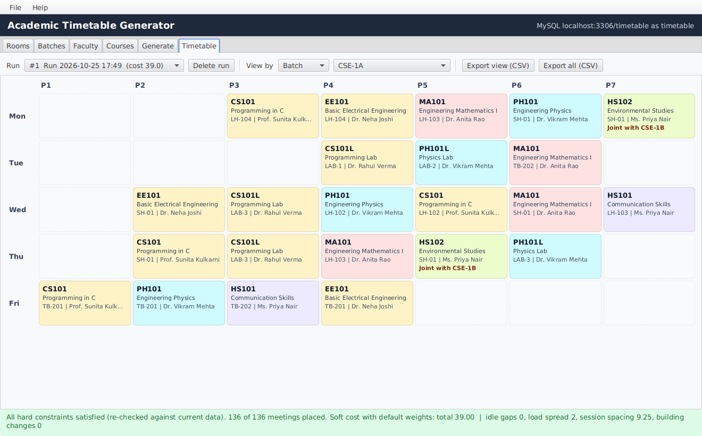
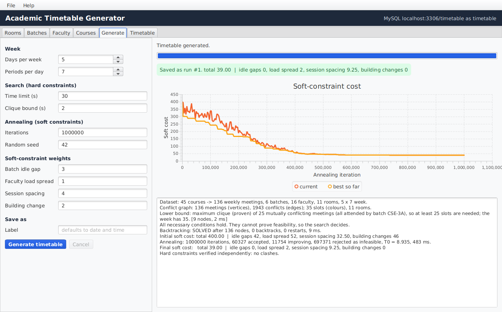
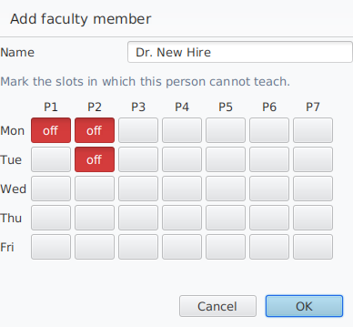
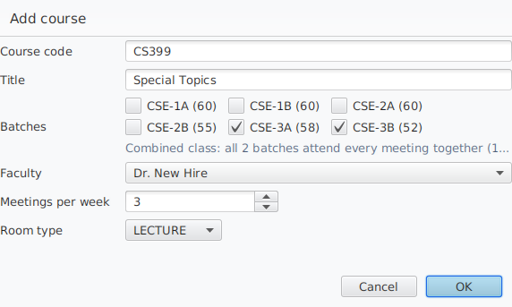
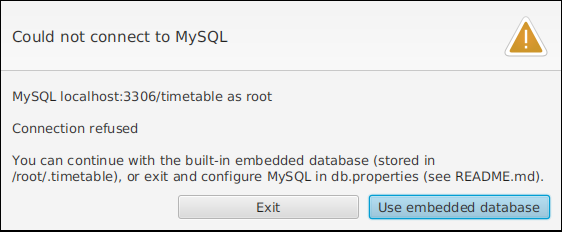

# Automated Academic Timetable Generator

A JavaFX desktop application, backed by MySQL through a JDBC DAO layer, that builds
**clash-free weekly timetables for an entire department**.

Timetabling is a hard problem (the decision version is NP-complete), so this is not just
forms over a database. Every course is decomposed into its weekly meetings and the problem is
modelled as **constrained graph colouring**: meetings are vertices, conflicts are edges and
time slots are colours. Before any search, a **maximum-clique lower bound** and
**Hall's-theorem matching checks** look for proofs that no timetable can exist. If none is
found, a **backtracking solver** (minimum-remaining-values ordering, saturation-degree
tie-breaking, forward checking, exact per-slot room matching and randomised restarts) finds a
timetable that satisfies every hard constraint. **Simulated annealing** then improves it
against a weighted soft-constraint objective: batch idle gaps, faculty load spread, session
spacing and building changes. It rejects every move that would break a hard constraint.



## Features

- **Data management**: rooms (type, capacity, building), batches, faculty with unavailable
  slots, and courses. A course can be attended by several batches together (combined classes
  and shared electives). Everything lives in MySQL, with searchable tables and validated forms.
- **Honest infeasibility handling**: when no timetable can exist, the generator says so
  *before searching* and explains why, for example "Batch CSE-3A has 36 meetings that must all
  be in different slots, but the week has only 35 slots". It reports exhausted searches and
  timeouts as different outcomes.
- **Hard constraints**: no batch, faculty member or room is double-booked; rooms have the
  right type (lecture/lab) and enough seats; faculty unavailability is respected.
- **Soft constraints**: few idle gaps, even daily load for teachers, sessions of a course
  spread across the week, and few building changes between consecutive classes. Each has an
  adjustable weight.
- **Live progress**: a log of every phase and a chart of the annealing cost curve. Runs
  happen on a background thread and can be cancelled.
- **Timetable views** per batch, faculty member or room. Each saved timetable is
  **re-validated against the current data** whenever it is opened, so later edits that
  invalidate it are flagged rather than hidden.
- **CSV export** of the visible grid or of the complete timetable (opens in Excel).
- **Embedded fallback database** (H2 in MySQL mode), so the app runs before MySQL is set up.
- **Headless CLI** for demos and benchmarks, and **37 automated tests**, including
  property tests that check the solver against brute-force enumeration on 3,000 random
  instances.

| Generate (log + cost curve) | Faculty availability editor | Combined class |
|---|---|---|
|  |  |  |

## Quick start

**You need:** a JDK, version 17 or newer (21 LTS recommended, for example
[Eclipse Temurin](https://adoptium.net/)). Maven is *not* required: the included Maven
Wrapper (`mvnw` / `mvnw.cmd`) downloads it on first use. MySQL 8 is optional at first (see
below).

Get the code and open a terminal in its folder:

```bash
git clone https://github.com/pajiala99/academic-timetable-generator.git
cd academic-timetable-generator
```

You can also download the ZIP from the repository page and unzip it.

**Windows (Command Prompt or PowerShell)**

```bat
mvnw.cmd javafx:run
```

**macOS / Linux**

```bash
./mvnw javafx:run
```

The first run downloads Maven, JavaFX and the JDBC drivers, which takes a minute or two.

- If MySQL is not set up yet, the app offers to continue with the **embedded database**
  (stored in `~/.timetable/`). On an empty database it offers to load the **sample
  Computer Science department** (6 batches, 16 faculty, 11 rooms, 45 courses, 136 weekly
  meetings, including 3 combined classes).
- To skip MySQL entirely: `./mvnw javafx:run -Djavafx.args="--embedded"`
  (PowerShell: `.\mvnw.cmd javafx:run "-Djavafx.args=--embedded"`).
- `--sample` loads the sample data into an empty database without asking.

Then open the **Generate** tab and click **Generate timetable**. The result opens in the
**Timetable** tab.

### Runnable jar

```bash
./mvnw package                     # also runs the tests; add -DskipTests to skip them
java -jar target/timetable-generator-1.0.0-all.jar            # or add --embedded / --sample
```

The jar bundles JavaFX for the operating system it was **built on**, so build it on the kind
of machine you will run it on.

### Opening in an IDE

Open the project folder as a Maven project in IntelliJ IDEA, Eclipse or VS Code.
Run the Maven goal `javafx:run`, or run the main class `edu.timetable.ui.Launcher`.

## Setting up MySQL

1. Install MySQL Server 8 and start it.
2. Create a database user (run as the MySQL root user):

   ```sql
   CREATE USER 'timetable'@'localhost' IDENTIFIED BY 'choose-a-password';
   GRANT ALL PRIVILEGES ON timetable.* TO 'timetable'@'localhost';
   ```

3. Copy `db.properties.example` to `db.properties` (in the folder you start the app from, or
   in `~/.timetable/`) and set `db.user` / `db.password`. The `timetable` database and all
   tables are created automatically on first start (`src/main/resources/sql/schema.sql`).
   You can also use the environment variables `TIMETABLE_DB_URL`, `TIMETABLE_DB_USER` and
   `TIMETABLE_DB_PASSWORD`.

The header of the main window shows which database is in use. If MySQL cannot be reached, the
app says why and offers the embedded database instead:



## Using the application

1. **Rooms, Batches, Faculty, Courses**: add, edit (double-click) and delete records. In the
   faculty editor, click slots to mark them *off*. In the course editor, tick several batches
   for a combined class. The database refuses deletions that would break references, for
   example deleting a batch that still has courses, and the app explains why.
2. **Generate**: set the shape of the week (days × periods), the search time limit,
   annealing iterations, random seed (runs are reproducible) and soft-constraint weights.
   Then click **Generate timetable**. The log shows the conflict graph size, the clique lower
   bound, the search statistics and the soft cost before and after annealing.
3. **Timetable**: choose a saved run and view it per batch, faculty member or room. Hover
   over a cell for details. Export the view or the whole timetable as CSV. The status bar
   re-checks every hard constraint against the *current* data.

## Command-line demo (no database needed)

```bash
./mvnw -q compile exec:java                                          # sample department, prints every batch's week
./mvnw -q compile exec:java -Dexec.args="--print faculty"            # ... or per faculty / room
./mvnw -q compile exec:java -Dexec.args="--overloaded"               # proven infeasible before search
./mvnw -q compile exec:java -Dexec.args="--overloaded --no-precheck --time-limit 20"   # search alone: times out
./mvnw -q compile exec:java -Dexec.args="--synthetic 40 --load 28 --seed 3 --print none"   # 1,100-meeting instance
```

Options: `--synthetic BATCHES`, `--load MEETINGS_PER_BATCH`, `--room-use FRACTION`,
`--seed S`, `--iterations N`, `--time-limit SECONDS`, `--print batch|faculty|room|none`,
`--no-precheck`.

## How it works

```
 MySQL --DAO--> Dataset --> Problem (meetings, conflict graph, domains)
                               |
                               v
                 Feasibility pre-checks ---- proof found ----> "infeasible, because ..."
                 (empty domains, max clique,
                  Hall matching on slots/rooms)
                               |
                               v
                 Backtracking search -------- exhausted -----> "infeasible (search)"
                 (MRV + DSatur + forward      time limit ----> "undecided"
                  checking + room matching)
                               | clash-free timetable
                               v
                 Simulated annealing (feasible moves only)
                               |
                               v
                 Independent validator --> saved to MySQL --> grid views, CSV
```

[docs/DESIGN.md](docs/DESIGN.md) explains the model, the algorithms and their correctness
arguments, the verification strategy, measured results and limitations.
[docs/PROJECT_PLAN.md](docs/PROJECT_PLAN.md) maps the work onto three team members
(persistence, solver engine, interface) and a week-by-week plan with a vertical slice by week 6.

### Measured results

Single runs on a cloud container with the default settings (1,000,000 annealing iterations,
which take about 0.3–0.4 s at every size):

| Instance | Meetings | Clique bound | Search | Soft cost: before → after annealing |
|---|---:|---|---|---|
| Sample department | 136 | 25, proven in 1 ms | 136 nodes, 0 backtracks, 10 ms | 441 → 41 |
| Synthetic, 12 batches | 330–332 | 28, 1 ms | 0 backtracks, 10–11 ms | 977–1,060 → 149–166 |
| Synthetic, 20 batches | 546–552 | 28, 1 ms | 0 backtracks, 19–23 ms | 1,813–1,983 → 296–328 |
| Synthetic, 40 batches | 1,101–1,108 | 28, 1–2 ms | 0 backtracks, 34–41 ms | 3,631–3,728 → 619–726 |
| Over-subscribed sample (36 meetings for one batch, 35 slots) | 147 | **36 > 35: infeasible, proven in 1 ms** | search alone: timeout after 17–26 million nodes (20 s and 30 s limits) | n/a |

On room-scarce synthetic instances (`--room-use 0.99`, 330–830 meetings), 24 of 24 were
solved; one needed restarts (7,007 nodes, 4 restarts, under 0.15 s).

## Tests

```bash
./mvnw test
```

There are 37 tests. Highlights:

- the solver agrees with **exhaustive brute force** on 3,000 random small instances
  (746 feasible, 2,254 infeasible, 6 of which only the search can prove);
- the pre-checks **never claim infeasibility for a feasible instance**;
- the clique finder matches exhaustive search;
- the annealer's incremental cost deltas equal full recomputation, and it never breaks a
  hard constraint;
- the DAO layer works against H2 in MySQL mode.

To run the DAO tests against a real MySQL server, pass a scratch database. It is wiped before
each test:

```bash
./mvnw test -Dtest=DataStoreTest \
  -Dtest.mysql.url="jdbc:mysql://localhost:3306/timetable_test?createDatabaseIfNotExist=true&allowPublicKeyRetrieval=true&useSSL=false" \
  -Dtest.mysql.user=timetable -Dtest.mysql.password=YOUR_PASSWORD
```

These all pass on MySQL 8.0.46.

## Project structure

```
academic-timetable-generator/
├── pom.xml, mvnw, mvnw.cmd          build (Java 17+, JavaFX 21, MySQL Connector/J 8.4, H2, JUnit 5)
├── db.properties.example            database settings template
├── docs/                            DESIGN.md, PROJECT_PLAN.md, screenshots
└── src/
    ├── main/java/edu/timetable/
    │   ├── model/     shared records: Room, Batch, Faculty, Course, TimeSlot, Dataset, ...
    │   ├── dao/       persistence: Database, DataStore, DAO interfaces + JDBC implementations
    │   ├── solver/    engine: Problem, FeasibilityChecker, CliqueFinder, BacktrackingSolver,
    │   │              SoftConstraintEvaluator, SimulatedAnnealer, HardConstraintValidator,
    │   │              TimetableEngine
    │   ├── service/   use cases: TimetableService, SampleData, TimetableGrid, CsvExporter, Cli
    │   └── ui/        JavaFX: TimetableApp, entity tabs, GenerateTab, TimetableTab, dialogs
    ├── main/resources/   sql/schema.sql, ui/app.css
    └── test/java/        solver, DAO and export tests
```

## Troubleshooting

- **"JavaFX runtime components are missing"**: start with `mvnw javafx:run` or the `-all`
  jar, or run `edu.timetable.ui.Launcher` (not `TimetableApp`) from an IDE.
- **"Public Key Retrieval is not allowed"** or other MySQL authentication errors: keep
  `allowPublicKeyRetrieval=true` in the URL (it is in the template), and check the user and
  password.
- **"Unsupported JavaFX configuration: classes were loaded from 'unnamed module'"**: this is
  a harmless warning when JavaFX is on the classpath.
- **A saved timetable is marked as no longer matching the data**: you edited courses, rooms
  or availability after generating it. Generate a new one.
