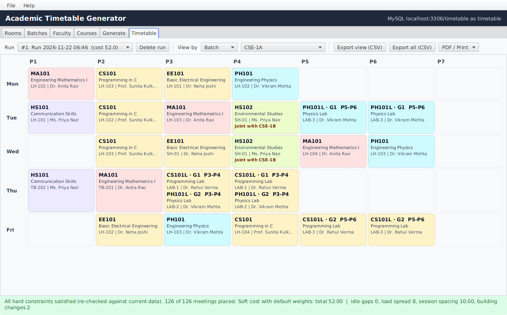
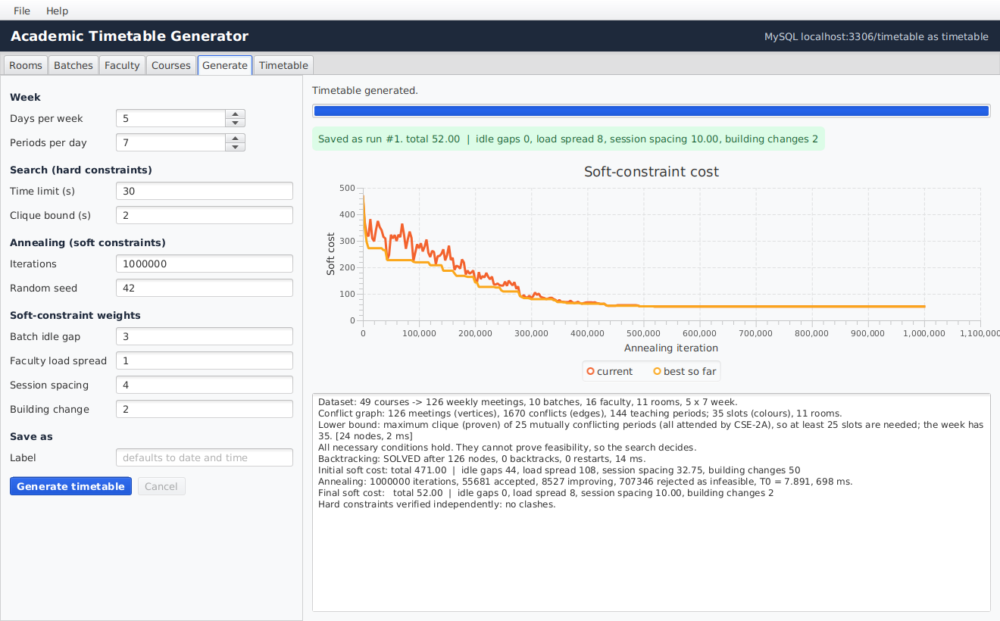
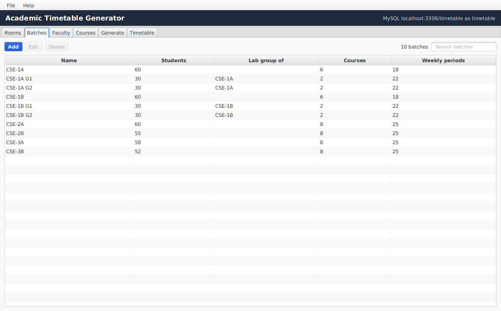
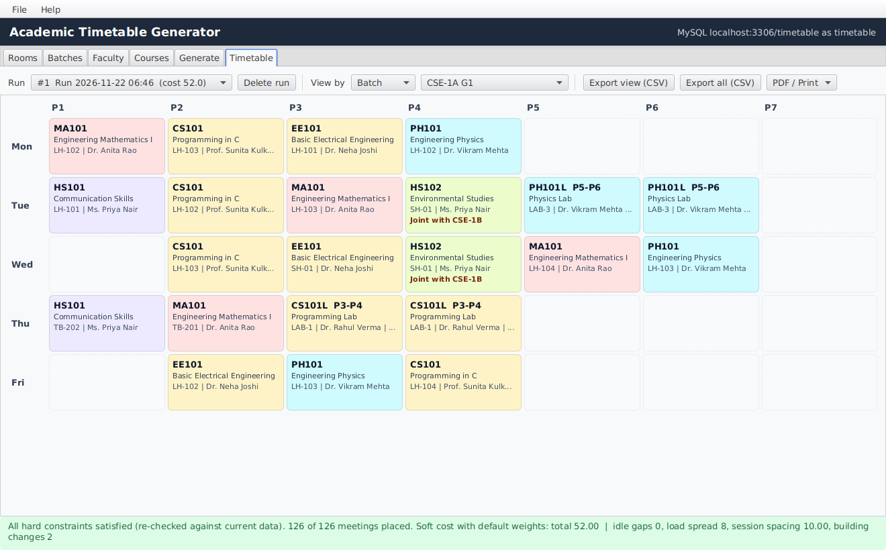
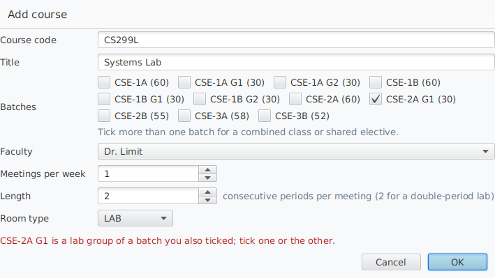
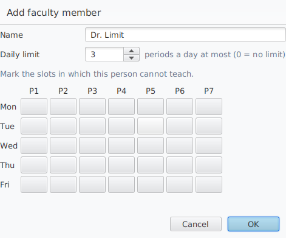
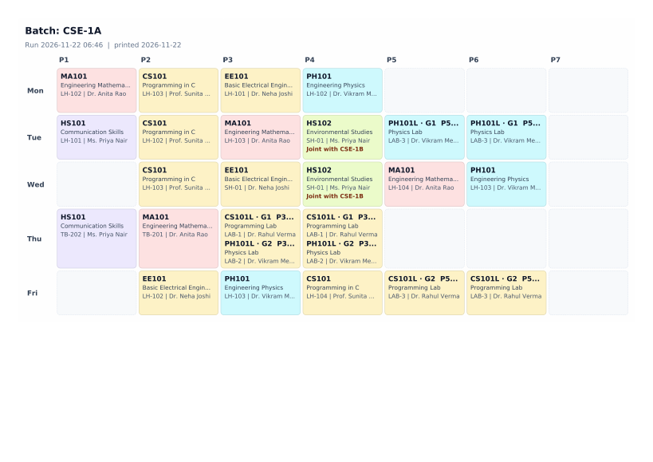
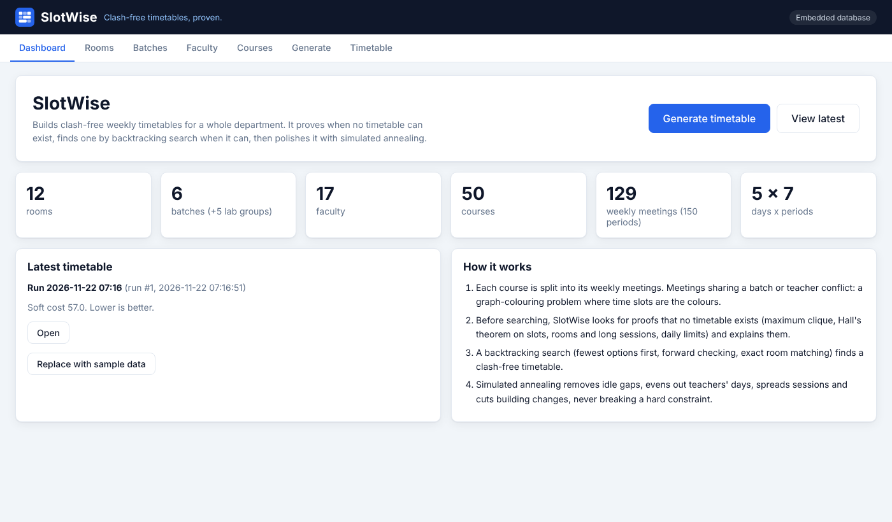
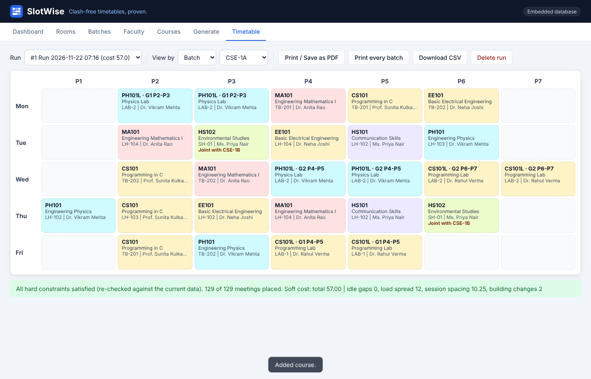
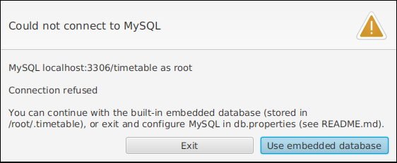

# SlotWise

**Clash-free timetables, proven.** An automated academic timetable generator.

[](https://github.com/pajiala99/academic-timetable-generator/actions/workflows/ci.yml)

A JavaFX desktop application, backed by MySQL through a JDBC DAO layer, that builds
**clash-free weekly timetables for an entire department**. The same engine also runs **in your
browser** (`--web`): one engine, two front ends.

Timetabling is a hard problem (the decision version is NP-complete), so this is not just
forms over a database. Every course is decomposed into its weekly meetings and the problem is
modelled as **constrained graph colouring**: meetings are vertices, conflicts are edges and
time slots are colours. Before any search, a **maximum-clique lower bound** and
**Hall's-theorem matching checks** look for proofs that no timetable can exist. If none is
found, a **backtracking solver** (minimum-remaining-values ordering, saturation-degree
tie-breaking, forward checking, exact per-slot room matching and randomised restarts) finds a
timetable that satisfies every hard constraint. **Simulated annealing** then improves it
against a weighted soft-constraint objective: batch idle gaps, faculty load spread, session
spacing and building changes. It rejects every move that would break a hard constraint.



## Features

- **Data management**: rooms (type, capacity, building), batches, faculty with unavailable
  slots, and courses. Everything lives in MySQL, with searchable tables and validated forms.
  It models what real departments need:
  - **double-period labs**: a course's sessions can last 2 or 3 consecutive periods, in one
    room on one day;
  - **lab groups**: a batch can be split into groups (CSE-1A G1/G2) that take labs separately,
    even at the same time in different labs, but attend lectures together;
  - **combined classes**: one course attended by several batches (a common lecture or shared
    elective);
  - **daily limits**: a maximum number of teaching periods per day for each teacher.
- **Honest infeasibility handling**: when no timetable can exist, the generator says so
  *before searching* and explains why, for example "Batch CSE-3A has 36 teaching periods that
  must all be in different slots, but the week has only 35 slots". It reports exhausted searches and
  timeouts as different outcomes.
- **Hard constraints**: no batch, lab group, faculty member or room is double-booked; rooms
  have the right type (lecture/lab) and enough seats; sessions stay within one day; faculty
  unavailability and daily limits are respected.
- **Soft constraints**: few idle gaps, even daily load for teachers, sessions of a course
  spread across the week, and few building changes between consecutive classes. Each has an
  adjustable weight.
- **Live progress**: a log of every phase and a chart of the annealing cost curve. Runs
  happen on a background thread and can be cancelled.
- **Timetable views** per batch, faculty member or room. Each saved timetable is
  **re-validated against the current data** whenever it is opened, so later edits that
  invalidate it are flagged rather than hidden.
- **Save as PDF** (one A4 page per batch, teacher or room; no printer needed), **printing**,
  and **CSV export** of the visible grid or of the complete timetable (opens in Excel).
- **Embedded fallback database** (H2 in MySQL mode), so the app runs before MySQL is set up.
- **Web version**: the same app in your browser, with a dashboard, live generation progress and
  printable timetables. It runs on your own computer only.
- **Headless CLI** for demos and benchmarks, and **50 automated tests**, including
  property tests that check the solver against brute-force enumeration on 3,000 random
  instances.

| Generate (log + cost curve) | Lab groups | A lab group's week |
|---|---|---|
|  |  |  |

| Double-period course editor | Daily limit and availability | Saved PDF page |
|---|---|---|
|  |  |  |

## Quick start

**You need:** a JDK, version 17 or newer (21 LTS recommended, for example
[Eclipse Temurin](https://adoptium.net/)). Maven is *not* required: the included Maven
Wrapper (`mvnw` / `mvnw.cmd`) downloads it on first use. MySQL 8 is optional at first (see
below).

Get the code and open a terminal in its folder:

```bash
git clone https://github.com/pajiala99/academic-timetable-generator.git
cd academic-timetable-generator
```

You can also download the ZIP from the repository page and unzip it.

**Windows (Command Prompt or PowerShell)**

```bat
mvnw.cmd javafx:run
```

**macOS / Linux**

```bash
./mvnw javafx:run
```

The first run downloads Maven, JavaFX and the JDBC drivers, which takes a minute or two.

- If MySQL is not set up yet, the app offers to continue with the **embedded database**
  (stored in `~/.timetable/`). On an empty database it offers to load the **sample
  Computer Science department**: 6 batches (the first-year sections split into lab groups
  G1/G2), 16 faculty with daily limits, 11 rooms, 49 courses and 126 weekly meetings
  (144 teaching periods), including 18 double-period lab sessions and 3 combined classes.
- To skip MySQL entirely: `./mvnw javafx:run -Djavafx.args="--embedded"`
  (PowerShell: `.\mvnw.cmd javafx:run "-Djavafx.args=--embedded"`).
- `--sample` loads the sample data into an empty database without asking.

Then open the **Generate** tab and click **Generate timetable**. The result opens in the
**Timetable** tab.

### Runnable jar

```bash
./mvnw package                     # also runs the tests; add -DskipTests to skip them
java -jar target/slotwise-1.1.0-all.jar           # desktop app; add --embedded / --sample
java -jar target/slotwise-1.1.0-all.jar --web     # browser version (see below)
```

The jar bundles JavaFX for the operating system it was **built on**, so build it on the kind
of machine you will run it on.

### Opening in an IDE

Open the project folder as a Maven project in IntelliJ IDEA, Eclipse or VS Code.
Run the Maven goal `javafx:run`, or run the main class `edu.timetable.ui.Launcher`.

## Web version (in your browser)

```bash
java -jar target/slotwise-1.1.0-all.jar --web --sample        # or: --embedded, --port 9000, --no-browser
```

SlotWise starts a small web server **on your own computer** (`127.0.0.1`, port 8080 or the
next free one) and opens your browser at `http://localhost:8080`. Nobody else on the network
can reach it. It uses the same database settings as the desktop app; if MySQL cannot be
reached it says so in the terminal and uses the embedded database. Press Ctrl+C to stop it.

- **Dashboard**: counts, the latest timetable, and "Generate timetable" in one click.
- **Rooms, Batches, Faculty, Courses**: searchable tables with add / edit / delete forms. They
  cover lab groups, daily limits, the availability grid, double periods and combined classes,
  with the same validation as the desktop app.
- **Generate**: every parameter and weight, a live progress bar, the run log and the cost curve.
- **Timetable**: per batch, lab group, teacher or room. **Print / Save as PDF** uses the
  browser's print dialog (choose "Save as PDF"; no printer needed). **Print every batch**
  prints one A4 page each, and **Download CSV** exports the whole timetable.

| Dashboard | Timetable in the browser |
|---|---|
|  |  |

## Setting up MySQL

1. Install MySQL Server 8 and start it.
2. Create a database user (run as the MySQL root user):

   ```sql
   CREATE USER 'timetable'@'localhost' IDENTIFIED BY 'choose-a-password';
   GRANT ALL PRIVILEGES ON timetable.* TO 'timetable'@'localhost';
   ```

3. Copy `db.properties.example` to `db.properties` (in the folder you start the app from, or
   in `~/.timetable/`) and set `db.user` / `db.password`. The `timetable` database and all
   tables are created automatically on first start (`src/main/resources/sql/schema.sql`).
   You can also use the environment variables `TIMETABLE_DB_URL`, `TIMETABLE_DB_USER` and
   `TIMETABLE_DB_PASSWORD`.

The header of the main window shows which database is in use. If MySQL cannot be reached, the
app says why and offers the embedded database instead:



## Using the application

1. **Rooms, Batches, Faculty, Courses**: add, edit (double-click) and delete records.
   - In the batch editor, choose "Lab group of" to make a batch a lab group of another.
   - In the faculty editor, set a daily limit and click slots to mark them *off*.
   - In the course editor, set the length of each meeting (2 for a double-period lab), and
     tick several batches for a combined class.

   The database refuses deletions that would break references, for example deleting a batch
   that still has courses or lab groups, and the app explains why.
2. **Generate**: set the shape of the week (days × periods), the search time limit,
   annealing iterations, random seed (runs are reproducible) and soft-constraint weights.
   Then click **Generate timetable**. The log shows the conflict graph size, the clique lower
   bound, the search statistics and the soft cost before and after annealing.
3. **Timetable**: choose a saved run and view it per batch, lab group, faculty member or room.
   A batch's view also shows its lab groups' sessions (marked "· G1"), and a lab group's view
   shows its batch's lectures. Hover over a cell for details. Use **PDF / Print** to save the
   timetable (or every timetable in the view, one page each) as a PDF or to print it, or
   export it as CSV. The status bar re-checks every hard constraint against the *current*
   data.

## Command-line demo (no database needed)

```bash
./mvnw -q compile exec:java                                          # sample department, prints every batch's week
./mvnw -q compile exec:java -Dexec.args="--print faculty"            # ... or per faculty / room
./mvnw -q compile exec:java -Dexec.args="--overloaded"               # proven infeasible before search
./mvnw -q compile exec:java -Dexec.args="--overloaded --no-precheck --time-limit 20"   # search alone: times out
./mvnw -q compile exec:java -Dexec.args="--synthetic 40 --load 28 --seed 3 --print none"   # 1,100-meeting instance
```

Options: `--synthetic BATCHES`, `--load MEETINGS_PER_BATCH`, `--room-use FRACTION`,
`--seed S`, `--iterations N`, `--time-limit SECONDS`, `--print batch|faculty|room|none`,
`--no-precheck`.

## How it works

```
 MySQL --DAO--> Dataset --> Problem (meetings, conflict graph, domains)
                               |
                               v
                 Feasibility pre-checks ---- proof found ----> "infeasible, because ..."
                 (empty domains, max clique,
                  Hall matching on slots/rooms)
                               |
                               v
                 Backtracking search -------- exhausted -----> "infeasible (search)"
                 (MRV + DSatur + forward      time limit ----> "undecided"
                  checking + room matching)
                               | clash-free timetable
                               v
                 Simulated annealing (feasible moves only)
                               |
                               v
                 Independent validator --> saved to MySQL --> grid views, CSV
```

[docs/HANDOFF.md](docs/HANDOFF.md) is the quickest overview: project status, how to run it,
a 5-minute presentation script, and how to continue in a Claude desktop chat.
[docs/DESIGN.md](docs/DESIGN.md) explains the model, the algorithms and their correctness
arguments, the verification strategy, measured results and limitations.
[docs/PROJECT_PLAN.md](docs/PROJECT_PLAN.md) maps the work onto three team members
(persistence, solver engine, interface) and a week-by-week plan with a vertical slice by week 6.

### Measured results

Single runs on a cloud container with the default settings (1,000,000 annealing iterations,
which take well under a second). Synthetic instances have a double-period lab course per
batch and some combined electives.

| Instance | Meetings | Clique bound | Search | Soft cost: before → after annealing |
|---|---:|---|---|---|
| Sample department | 126 | 25, proven in 2 ms | 126 nodes, 0 backtracks, 10 ms | 508 → 49 |
| Synthetic, 12 batches | 313–314 | 28, 3 ms | 0 backtracks, 19–23 ms | 999–1,191 → 142–160 |
| Synthetic, 20 batches | 515–519 | 28, 5–6 ms | 0 backtracks, 31–42 ms | 1,776–1,884 → 281–314 |
| Synthetic, 40 batches | 1,042–1,048 | 28, 9–10 ms | 1 restart, 91–98 ms | 3,597–3,700 → 684–708 |
| Over-subscribed sample (36 periods for one batch, 35 slots) | 137 | **36 > 35: infeasible, proven in 2 ms** | search alone: timeout after about 6 million nodes (20 s limit) | n/a |
| 20 batches with one lab room too few (31 double sessions, room for 30) | 515 | **long-session check: infeasible, proven in 0.14 s** | an earlier version searched for 30 s and gave up | n/a |

On room-scarce synthetic instances (`--room-use 0.99`, 510–790 meetings), 24 of 24 were
solved; 7 needed restarts, the hardest 6,975 nodes and 0.27 s.

## Tests

```bash
./mvnw test
```

There are 50 tests. Highlights:

- the solver agrees with **exhaustive brute force** on 3,000 random small instances with
  double periods, lab groups, combined classes and daily limits (464 feasible, 2,536
  infeasible, 9 of which only the search can prove). Every brute-force solution also passes
  the independent validator;
- the pre-checks **never claim infeasibility for a feasible instance**;
- the clique finder matches exhaustive search;
- the annealer's incremental cost deltas equal full recomputation, and it never breaks a
  hard constraint;
- the web API works over real HTTP: pages, validation, refusals, generation, grids and CSV;
- the DAO layer works against H2 in MySQL mode, and a database created by the first release is
  upgraded in place (new columns added, data kept).

To run the DAO tests against a real MySQL server, pass a scratch database. It is wiped before
each test:

```bash
./mvnw test -Dtest=DataStoreTest \
  -Dtest.mysql.url="jdbc:mysql://localhost:3306/timetable_test?createDatabaseIfNotExist=true&allowPublicKeyRetrieval=true&useSSL=false" \
  -Dtest.mysql.user=timetable -Dtest.mysql.password=YOUR_PASSWORD
```

These all pass on MySQL 8.0.46.

## Project structure

```
academic-timetable-generator/
├── pom.xml, mvnw, mvnw.cmd          build (Java 17+, JavaFX 21, MySQL Connector/J 8.4, H2, Jackson,
│                                    PDFBox, JUnit 5)
├── db.properties.example            database settings template
├── docs/                            DESIGN.md, PROJECT_PLAN.md, screenshots
└── src/
    ├── main/java/edu/timetable/
    │   ├── model/     shared records: Room, Batch, Faculty, Course, TimeSlot, Dataset, ...
    │   ├── dao/       persistence: Database, DataStore, DAO interfaces + JDBC implementations
    │   ├── solver/    engine: Problem, FeasibilityChecker, CliqueFinder, BacktrackingSolver,
    │   │              SoftConstraintEvaluator, SimulatedAnnealer, HardConstraintValidator,
    │   │              TimetableEngine
    │   ├── service/   use cases: TimetableService, SampleData, TimetableGrid, CsvExporter,
    │   │              PdfExporter, Cli
    │   ├── ui/        JavaFX: TimetableApp, entity tabs, GenerateTab, TimetableTab, dialogs
    │   └── web/       browser version: WebServer, Api (JSON), GenerationJob, Http
    ├── main/resources/   sql/schema.sql, ui/app.css, web/ (index.html, app.js, style.css)
    └── test/java/        solver, DAO, export and web API tests
```

## Troubleshooting

- **"JavaFX runtime components are missing"**: start with `mvnw javafx:run` or the `-all`
  jar, or run `edu.timetable.ui.Launcher` (not `TimetableApp`) from an IDE.
- **"Public Key Retrieval is not allowed"** or other MySQL authentication errors: keep
  `allowPublicKeyRetrieval=true` in the URL (it is in the template), and check the user and
  password.
- **"Unsupported JavaFX configuration: classes were loaded from 'unnamed module'"**: this is
  a harmless warning when JavaFX is on the classpath.
- **A saved timetable is marked as no longer matching the data**: you edited courses, rooms
  or availability after generating it. Generate a new one.

---

**Hardik Pajiala** · [LinkedIn](https://linkedin.com/in/hardik-pajiala) · [Portfolio](https://pajiala99.github.io) · [GitHub](https://github.com/pajiala99)
